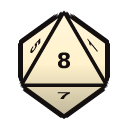

# Disciplines

Disciplines are the powers of the blood. Each has dots from 1 to 7. Every dot unlocks a power on
the vampire's gizmo bar, and some Disciplines also give an always-on bonus that grows with dots.

## How they work

- **Dots.** A new vampire places three dots among its clan's Disciplines. More come from
  experience (see [Character sheet](Character-Sheet.md#experience)).
- **The cap.** Most vampires stop at 5. Dots 6 and 7 are the elder powers, open only to the 7th
  generation and lower (6 at the 7th, 7 at the 6th).
- **In-clan or not.** In-clan Disciplines cost less. Learning one from outside the clan needs a
  teacher, and that means tasting the teacher's blood (a blood bond step). Celerity, Fortitude
  and Potence can be self-taught at a higher price. Caitiff pay the same middling price for
  everything.
- **Cost.** Most powers cost blood, some Willpower, some nothing. The physical Disciplines'
  surges spend blood within the vampire's per-turn limit.
- **Rolls.** Many powers roll dice, usually an Attribute plus an Ability. Mental powers are
  contests against the target's Willpower or a Virtue. Results show in the roll log.
- **The Masquerade.** Every power is either quiet, subtle, or overt. Subtle and overt powers
  used in front of outsiders can make witnesses. See [The Masquerade and hunters](Masquerade-and-Hunters.md).
- **Forms.** Shapeshifting powers (Protean, Vicissitude, Obtenebration and others) put the
  vampire's gear away while it's changed.
- **Body-leaving.** Possession, Subsume the Spirit and Psychic Projection leave the vampire's
  body asleep while its mind is elsewhere. Protect the body.

## Reading the tables

| Column | Meaning |
|---|---|
| Dot | The dot in the Discipline that unlocks the power |
| Cost | Blood and Willpower paid when it's cast. Blank means nothing fixed: free, or paid by the power itself as it goes (Look Alive costs 8 blood minus Humanity, for one) |
| Reach | Self, Touch (the next cell), or how many cells away it can be aimed |
| Cooldown | How long before it can be used again, in game time: s for seconds, h for hours |

## Every vampire has these

| | Power | Cost | Reach | Cooldown | What it does |
|---|---|---|---|---|---|
|  | **Blood Buff** | 1 blood | Self |  | Push a point of blood into the body for an extra dot of Strength, Dexterity or Stamina for four hours. Cast it again to stack, up to the most this generation allows. |
|  | **Steel the Will** | 1 Willpower | Self | 8 h | Spend a point of Willpower to shut the pain out for four hours. Wounds still slow the body down, but they no longer hurt or knock the vampire down from the pain. |
|  | **Look Alive** |  | Self | 1 h | Push blood into the skin and lungs to pass as a living person until dawn: warm to the touch, breathing, with colour in the face. Hunters don't see the pallor and low Humanity stops showing. Free at Humanity 8 or more; below that it costs a blood point for every step under 8. A vampire on a Path can't do it. |

Two more need no button. Blood heals wounds by itself, as the heal policy allows (see
[Being Kindred](Being-Kindred.md#healing)), and the fangs are a melee bite that drinks (see
[Feeding](Feeding.md#biting-in-combat)).

## Powers that come with another

Some buttons only show up while something else is going on: a power that's running, a form,
or a relic someone is wearing or holding.

| | Power | Comes with | Cost | Reach | Cooldown | What it does |
|---|---|---|---|---|---|---|
|  | **Go There** | Subsume the Spirit |  | 500 cells |  | Send the animal to a spot. |
|  | **Attack** | Subsume the Spirit |  | 500 cells |  | Set the animal on someone. |
|  | **Let Go** | Subsume the Spirit |  | Self |  | Leave the animal and wake in the vampire's own body. |
|  | **Guard Here** | Guardian Blades |  | 30 cells |  | Send the blade to hang over another spot and guard that instead. |
|  | **Call Lightning** | Storm-caller | 1 Willpower | 30 cells | 3 s | Bring the storm's lightning down on a spot under open sky, for a Willpower point. |
|  | **Open the way to Amenti** | Uraeus of Osiris | 1 Willpower | Self | 8 h | Burn the body of a mortal sacrifice lying beside the bearer, holding the Uraeus, and spend a point of Willpower. If the rite was done right (Intelligence and Occult at 9), the smoke opens a way into the lands of the dead, and the bearer walks there for about an hour and a half per success: nobody living can see or target them, and walls are no obstacle. |
|  | **Look through the Monocle** | Monocle of Clarity | 1 blood | Self | 10 s | Spend a blood point and look hard through the Monocle of Clarity. For an hour, Obfuscate and Chimerstry nearby are seen through as if by Auspex 7: hidden Kindred come out, and other people's illusions fall apart. A roll of Perception and Occult may show what else is hidden around, the dead included; a botch shows something nobody should see, and costs Willpower. |

## What mind powers leave behind

Mind powers that win put their target in a state that shows over its head until it ends:

- **Mesmerized**: carrying out a Dominate order, then coming to with no memory of it.
- **Transfixed**: standing still, lost in thought, until something hurts it (Recurring
  Contemplation, Paradox, the Riddle Phantastique).
- **Beckoned**: an animal coming to the vampire's call, then wandering back to the wild.
- **Quelled**: wandering off with no will to fight for a few minutes (Quell the Beast).

## All Disciplines

[Animalism](#animalism) · [Auspex](#auspex) · [Bardo](#bardo) · [Celerity](#celerity) · [Chimerstry](#chimerstry) · [Daimoinon](#daimoinon) · [Dementation](#dementation) · [Dominate](#dominate) · [Flight](#flight) · [Fortitude](#fortitude) · [Melpominee](#melpominee) · [Mytherceria](#mytherceria) · [Obeah](#obeah) · [Obfuscate](#obfuscate) · [Obtenebration](#obtenebration) · [Ogham](#ogham) · [Potence](#potence) · [Presence](#presence) · [Protean](#protean) · [Quietus](#quietus) · [Sanguinus](#sanguinus) · [Serpentis](#serpentis) · [Spiritus](#spiritus) · [Temporis](#temporis) · [Thanatosis](#thanatosis) · [Valeren](#valeren) · [Vicissitude](#vicissitude) · [Visceratika](#visceratika)

Thaumaturgy, Necromancy and Koldunic Sorcery are on
[Blood sorcery](Blood-Sorcery.md).

### Animalism

Kinship with the Beast in every creature: speaking to animals, calling them, and later quieting or unleashing the Beast in people. At 6, animal blood goes twice as far.

*Always on:* Speaks to the Beast in every animal. Taming and training come easily.

| | Dot | Power | Cost | Reach | Cooldown | What it does |
|---|---|---|---|---|---|---|
|  | 1 | **Feral Whispers** |  | 24.9 cells | 40 s | Speak to an animal in the language of the Beast. One in a rage, like a manhunter, calms at once; any other follows the vampire for three days if it fails to resist, breaking off only to eat and sleep. Manipulation and Animals against the animal's will. |
|  | 2 | **Beckoning** | 1 blood | Self | 4 h | Howl, screech or whistle, and the wild answers. Pick a kind of wild animal nearby, and up to five of them come to the vampire and guard it for about six hours, going for anyone who threatens it. |
|  | 3 | **Quell the Beast** |  | 24.9 cells | 4 h | Stare down the Beast in someone else. A person who fails to resist wanders off with no will to fight for a few minutes. A frenzied vampire is calmed at once. Manipulation and Social against the target's Willpower. |
|  | 4 | **Subsume the Spirit** | 1 blood | 24.9 cells | 2 days | Pour the vampire's mind into an animal for eight hours. The vampire's own body falls asleep where it stands, and any harm to it calls the mind back. The animal takes orders like a colonist: right-click to send it somewhere or set it on someone, or use its buttons to go, attack or let go. A wild animal has to fail to resist first. Manipulation and Animals against its will. A second roll, Manipulation and Animals, decides which of its own powers it can use from there: Auspex with two successes, Presence with three, Dominate and Dementation with four, Chimerstry and blood sorcery with five. |
|  | 5 | **Drawing Out the Beast** | 1 Willpower | 24.9 cells | 1 h | Pick a victim. For the next hour, if this vampire would frenzy while the victim is within fifteen cells, the victim goes berserk in its place. |
|  | 7 | **Conquer the Beast** |  | Self | 1 h | Let the Beast out on purpose and keep hold of the reins: Willpower at 7 to ride the wave of a frenzy for an hour. A botch lets it loose for real. Frenzies that come on their own can be ridden too, for a Willpower point and a roll at 9. |

### Auspex

Senses beyond the human: sharper sight and hearing, reading auras and objects, and in time leaving the body behind. At 6, the vampire reads a conversation before it happens.

| | Dot | Power | Cost | Reach | Cooldown | What it does |
|---|---|---|---|---|---|---|
|  | 1 | **Heightened Senses** |  | Self | 1 s | Sharpen sight and hearing far past a mortal's. While they're on, hidden Kindred within twelve cells are seen through if this vampire's Auspex beats their Obfuscate, but an explosion stuns. Use again to let them dull. |
|  | 2 | **Aura Perception** |  | 24.9 cells | 10 s | Read the colours around a person: whether they are Kindred, and of what clan and generation, or how close a mortal is to breaking and what they think of vampires. For a day afterwards, this vampire's rolls against them get two extra dice. |
|  | 3 | **The Spirit's Touch** |  | Touch | 10 s | Handle a thing and feel what was done with it. A corpse gives up its killer, who stays read for a week (rolls against the killer get two extra dice), and a sealed casket gives up what sleeps inside. |
|  | 4 | **Telepathy** |  | 500 cells | 1 h | Reach into a mind anywhere on the map. One of the colony's own is steadied for four hours and breaks less easily. Anyone else gives up what they're thinking about and, if they came with a group, what the group plans and when it moves. Reading another vampire costs a point of Willpower. Perception and Social against the target's Willpower. For a day after a reading, the vampire's own rolls against them get two extra dice. |
|  | 5 | **Psychic Projection** | 1 Willpower | Self | 2 days | Leave the body for eight hours as an unseen double that nothing can touch. It walks where it likes and looks into rooms, but can't work, fight or carry anything. The vampire's body sleeps meanwhile, and any harm to it calls the mind home. Once a projection it can fly out over the world and look into a settlement, finding any court the Kindred keep hidden there. It can still use Auspex, and with three successes on Perception and Awareness the other powers that need no body: Animalism, Dementation, Dominate, Obtenebration, Presence and blood sorcery. |
|  | 7 | **Mirror Reflex** | 1 blood | Self | 8 h | Read the reflexes of everyone in reach. For four hours the vampire hits more often and is hit less. |

### Bardo

The Children of Osiris' discipline of denial: lost Humanity won back, sorcery turned aside, animal blood made enough, a pillar to meditate at, and riddles that show a listener how small it is. A dot is lost whenever Humanity falls below it.

*Always on:* The Children of Osiris' discipline of denial, held up by Humanity. From the third dot, the Gift of Apis: animal blood feeds this vampire as well as human blood does.

| | Dot | Power | Cost | Reach | Cooldown | What it does |
|---|---|---|---|---|---|---|
|  | 1 | **Restore Humanitas** |  | Self | 1 h | Within a week of losing a dot of Humanity, meditate for hours to win it back. It takes every drop of blood in the body, and Conscience against the dot being regained. Once for each loss. |
|  | 2 | **Banishing Sign of Thoth** | 1 blood | Self | 10 s | Make the sign Thoth taught Osiris. For a minute, the next power aimed at the Child's mind loses a success for each one rolled here. |
|  | 4 | **Pillar of Osiris** | 1 Willpower | 2.9 cells | 1 day | Spend a long meditation making a place a Pillar of Osiris. Anyone who knows Bardo rolls two extra dice within eight cells of it. Once the Child has learned this, every week it goes without a night by a Pillar makes frenzy harder to hold back. |
|  | 5 | **Paradox** | 1 Willpower | 24.9 cells | 4 h | Speak a riddle that shows a listener how small they are against all of creation. If it beats their will, they stand lost in it for up to four hours, or until hurt. |
|  | 6 | **Boon of Anubis** | 1 Willpower | Touch | 1 day | Kiss a mortal on the forehead and ask the judge of the dead to pass them by: for fifteen days per success, any Embrace of them fails and leaves them asleep. Humanity at 6. |
|  | 7 | **Bring Forth the Dawn** | 3 blood | 24.9 cells | 12 h | A gesture, and every enemy vampire within eight cells of a spot feels the sun come up and falls into the daysleep for four hours per net success. Manipulation + Occult against each one's Humanity or Path; the Setites resist with two dice fewer. |

### Celerity

Speed the eye can't follow. The vampire moves and strikes faster, and can burn blood to blur for a moment.

*Always on:* The blood runs fast, and so does the body. Faster on foot and in a fight, and harder to catch with a blade.

| | Dot | Power | Cost | Reach | Cooldown | What it does |
|---|---|---|---|---|---|---|
|  | 1 | **Blur** | 1 blood | Self | 8 h | Burn blood and move faster than mortal eyes can follow: quicker on foot, with weapons and at work, for four hours. Mortals who catch the blur may become witnesses. Stronger from Celerity 3, and twice as long at 5. |
|  | 6 | **Projectile** | 1 blood | 30 cells | 5 s | Put the body's speed into a thrown stone. It flies faster than a bullet and hits like a sledgehammer. |
|  | 7 | **Flower of Death** | 2 blood | Self | 4 h | For four hours, all of the vampire's Celerity goes into every blow: melee hits land harder and more often. |

### Chimerstry

The Ravnos art of illusion: figures that aren't there, walls and guns made of nothing, phantom beasts, illusions that last, and pain that is all in the mind.

| | Dot | Power | Cost | Reach | Cooldown | What it does |
|---|---|---|---|---|---|---|
|  | 1 | **Ignis Fatuus** | 1 Willpower | 24.9 cells | 1.44 h | Conjure a lone figure at a spot for two minutes. Enemies take it for real and shoot at it, until a blow passes through it and the attacker sees the trick. |
|  | 2 | **Fata Morgana** | 1 blood, 1 Willpower | 24.9 cells | 4 h | Conjure a solid-looking illusion for eight hours: a wall nobody sees through or walks through, a gun emplacement that draws every shot, or splendour that makes a cellar look like a ballroom and lifts the room's beauty. A blow from someone who resists the illusion ends it. Manipulation and Social against the attacker's Willpower. |
|  | 3 | **Apparition** | 1 blood | 24.9 cells | 4 h | Conjure two phantom wolves that run at the vampire's enemies for four hours. They draw attacks and seem to bite, but do no harm and take none; a hard enough hit makes one vanish. |
|  | 4 | **Permanency** | 1 blood | 24.9 cells | 10 s | Make one of the vampire's illusions or phantoms last until it is dispelled or seen through. |
|  | 5 | **Horrid Reality** | 2 Willpower | 24.9 cells | 12 h | Convince one person they are burning, or being torn apart, for four hours. The pain is real enough to drop most people, but no wound comes of it, so nobody dies of it. A vampire who believes it is burning has to master its fear of the fire as well. Manipulation and Social against the target's Willpower. |
|  | 6 | **Shared Nightmare** | 3 blood, 2 Willpower | 24.9 cells | 12 h | Horrid Reality on a crowd: the target and every enemy within four cells of them, each resisting on their own. |
|  | 7 | **Suspension of Disbelief** | 1 Willpower | Self | 1 day | Whatever they saw, they decide it was a trick. Manipulation + Social at 7; one to five successes clear 5, 10, 25, 50 or every Masquerade witness on the map. |

### Daimoinon

The Baali's black arts: finding where a soul is weak, turning its fears on it, cold black hellfire, a fight with one's own demon, and curses. At 6 a devil's bargain makes the vampire proof against fire.

*Always on:* The Baali's dark art. From the sixth dot, a pact with the vampire's masters has made it proof against fire.

| | Dot | Power | Cost | Reach | Cooldown | What it does |
|---|---|---|---|---|---|---|
|  | 1 | **Sense the Sin** |  | 9.9 cells | 10 s | Find where someone is weakest: a vampire's lowest Virtue, a mortal's worst trait. The Baali knows them well enough for a day to use it. |
|  | 2 | **Fear of the Void Below** |  | 24.9 cells | 20 s | Talk to someone whose weakness the Baali knows and turn their fears on them. One success leaves them terrified, two send them running, three knock them senseless. A vampire may shrug it off with its Courage. |
|  | 3 | **Conflagration** | 1 blood | 15.9 cells | 5 s | Hurl a bolt of black, cold hellfire. It burns like any fire once it lands, aggravated to Kindred, and other vampires fear it as they fear any flame. |
|  | 4 | **Psychomachia** | 1 blood | 24.9 cells | 30 s | Set someone whose weakness the Baali knows against a phantom of their own darkest self. If their lowest Virtue fails them, the fight hurts as if it were real. A bad failure drives a vampire into frenzy, a mortal into a berserk rage. |
|  | 5 | **Condemnation** | 1 Willpower | 24.9 cells | 2 h | Lay a curse. Half the successes, rounded up, decide how bad it is: a lying tongue, a weak body, friends turned cold, barren blood, or doom, where every failure is a disaster. The rest decide how long: a night, a week, a season, a year, ten years. |
|  | 7 | **Summon the Herald of Topheth** | 3 blood | Self | 1 day | A blasphemous rite calls one of the masters' servants into the world. It fights for the vampire for a night. Nothing in the rite sends it back, so for its last hour it turns on everyone. |

### Dementation

The madness of the Malkavians, passed on to others: feelings stirred or dulled, phantoms, glimpses of hidden patterns, and minds broken outright.

| | Dot | Power | Cost | Reach | Cooldown | What it does |
|---|---|---|---|---|---|---|
|  | 1 | **Passion** |  | 24.9 cells | 20 s | Reach into someone's feelings and stir them up into a giddy high, or dull them to grey, for a day. The colony's own allow it; anyone else must fail to resist. Charisma and Social against the target's Willpower. |
|  | 2 | **The Haunting** | 1 blood | 24.9 cells | 1 h | Set phantoms on someone for three days: bad sleep, sudden frights, and now and then a fit of terror. Manipulation and Social against the target's Willpower. |
|  | 3 | **Eyes of Chaos** |  | Self | 1 day | See the patterns under everything for a day: research goes a quarter faster, and the vampire can tell which colonists are close to breaking. Looking that deep sometimes sets off one of its own derangements. |
|  | 3 | **Eyes of Chaos: Read Someone** |  | 12 cells | 1 h | Stare into the pattern of one person's soul until it gives up what they hide: their true nature, and whether another vampire's hand is on them, a Sabbat pack's errand, or a hunter's purpose. Perception and Occult. For a day the vampire's own rolls against them get two extra dice. |
|  | 4 | **Voice of Madness** | 1 blood | Self | 12 h | Speak in a voice that unhinges everyone who hears it. Every person within eight cells, friend or foe, who fails to resist flies into a rage or runs in terror for a few seconds, and the vampire's own Beast stirs. Manipulation and Social against each listener's Willpower. |
|  | 5 | **Total Insanity** | 1 blood | 24.9 cells | 1 day | Pour the Malkavian madness into another mind: three derangements at once, for five days. Manipulation and Social against the target's Willpower. |
|  | 6 | **Lingering Malaise** | 1 Willpower | 4.9 cells | 1 day | A minute's talk that leaves a mind broken for good: a derangement that never goes away. Manipulation and Social against the target's Willpower. Once a day. |
|  | 7 | **Restructure** | 1 Willpower | 24.9 cells | 1 day | Rewrite who someone is. With eye contact and at least as many successes as their Self-Control, one of their traits is swapped for one of the vampire's. |

### Dominate

One look, and another mind bends to the vampire's will

| | Dot | Power | Cost | Reach | Cooldown | What it does |
|---|---|---|---|---|---|---|
|  | 1 | **Command** |  | 12 cells | 10 s | Meet someone's eyes and say one word, and they obey before they know it: drop the weapon, run, sleep where they stand, or freeze. Manipulation and Social against the target's Willpower. |
|  | 2 | **Mesmerize** |  | 12 cells | 1 h | Look into someone's eyes and plant an order deep enough to be carried out later: leave this place for good, turn on their own friends for a few seconds, or walk to a chosen spot and wait there. Manipulation and Social against the target's Willpower. |
|  | 3 | **The Forgetful Mind** |  | 12 cells | 1 h | Reach into someone's memory and cut something out: everything bad the vampires have done to them, or the whole of the last day. The colony's own allow it; anyone else must fail to resist. |
|  | 4 | **Conditioning** |  | 3 cells | 1 h | One long session a day, bending a prisoner or one of the colony's own toward the vampire's will. Each session wears a prisoner's resistance down. After the third the subject is a thrall: never breaks, but learns slowly and thinks less for itself. Another vampire's Dominate finds a thrall hard to move. |
|  | 5 | **Possession** |  | 12 cells | 2 days | Push the vampire's mind into a mortal's body and wear it for half a day, sunlight and all. The mortal is the colony's to command until then, and goes back to its own people after. The vampire's body sleeps, and any harm to it calls the mind home; the host dying stuns the vampire. Manipulation and Social against the target's Willpower. A second roll, Manipulation and Social, decides which of its own powers it can use from there: Auspex with two successes, Presence with three, Dominate and Dementation with four, Chimerstry and blood sorcery with five. |

### Flight

The Gargoyles' wings. Each dot carries them farther in one flight, and from the second they are quicker on the ground too.

*Always on:* Wings of stone that grow stronger with use. From the second dot they lend speed on the ground as well.

| | Dot | Power | Cost | Reach | Cooldown | What it does |
|---|---|---|---|---|---|---|
|  | 1 | **Take Wing** |  | 30 cells | 5 s | Fly to a spot in sight: six cells for every dot of Flight. |

### Fortitude

The dead body refuses to break. Wounds land lighter, and even sunlight and fire bite less deep.

*Always on:* The Blood holds this body together where a living one would come apart. Every wound lands lighter.

| | Dot | Power | Cost | Reach | Cooldown | What it does |
|---|---|---|---|---|---|---|
|  | 1 | **Endure** | 1 blood | Self | 8 h | Burn blood and let it harden the dead flesh for four hours: less damage from everything, and nothing staggers the vampire. At Fortitude 5 the sun burns half as hard while it lasts. |
|  | 6 | **Personal Armor** | 2 blood | Self | 4 h | For four hours the skin is hard as steel. A blade that hits may shatter, and anyone who lands a punch feels it in their own bones. |
|  | 7 | **Shared Strength** | 3 blood, 1 Willpower | Touch | 4 h | Press a drop of blood onto someone's forehead and lend them the vampire's toughness: they take half damage for four hours per success. Stamina + Survival at 8. |

### Melpominee

The Daughters of Cacophony's power of the voice

| | Dot | Power | Cost | Reach | Cooldown | What it does |
|---|---|---|---|---|---|---|
|  | 1 | **The Missing Voice** |  | 29.9 cells | 10 s | Throw the voice to any spot in sight. Enemies near it who have nothing better to do go to see who is talking. One already fighting turns to look too, unless it resists: Manipulation and Social against its Willpower. |
|  | 2 | **Phantom Speaker** | 1 blood | 200 cells | 1 h | Speak or sing into the ear of anyone on the map, wherever they are. A friend takes heart from it; a prisoner or a foe is unsettled by a voice out of nowhere. A prisoner's resistance wears down a little, and a foe in a fight falters for a moment. |
|  | 3 | **Madrigal** |  | Self | 1 h | A song that makes everyone near feel what the singer wants. Friends are moved for a day; each success sends a fifth of the foes in earshot running. |
|  | 4 | **Siren's Beckoning** |  | 24.9 cells | 30 s | Sing someone into madness. If the song beats their will, they gain a derangement for a night, and a night more for each extra success. It leaves when the song wears off. |
|  | 5 | **Virtuosa** | 1 blood | Self | 2 h | The siren's song for a whole crowd: every enemy within earshot has to fight off the madness. A blood point covers five listeners, and one more for every five after. |
|  | 6 | **Shattering Crescendo** | 1 blood | 12 cells | 10 s | A song, even a lullaby, that splits skin and cracks bone in one listener up to twelve cells away. Each success is an aggravated wound no armour stops. Stamina + Artistic against the target's Stamina and Fortitude. |
|  | 7 | **Persistent Echo** | 1 blood | 12 cells | 1 h | Leave a Shattering Crescendo hanging over a spot for up to five days. The colony walks through it untouched; the first enemy to step in hears it all at once. |

### Mytherceria

The Kiasyd's fae-like powers: lies laid bare, hidden purposes seen, memories drawn out of objects, sigils that leave a mind lost, and riddles that hold it fast.

| | Dot | Power | Cost | Reach | Cooldown | What it does |
|---|---|---|---|---|---|---|
|  | 1 | **Folderol** |  | 4.9 cells | 1 h | Talk to someone and hear the lie in what they say. A thrall of an outside vampire, or a Sabbat plant, is found out. For a day the vampire's own rolls against them get two extra dice. |
|  | 2 | **Fae Sight** |  | 24.9 cells | 20 s | Look at someone with eyes that see magic other than the dead's. A hunter's purpose shows plainly, and so does True Faith. For a day the vampire's own rolls against them get two extra dice. |
|  | 3 | **Aura Absorption** |  | Touch | 10 s | Handle a thing and soak up what was done with it, as the Spirit's Touch does. A corpse gives up its killer, who stays read for a week (rolls against the killer get two extra dice), and a sealed casket gives up what sleeps inside. |
|  | 4 | **Chanjelin Ward** |  | Touch | 1 h | Draw a sigil on someone that leaves them lost and slow-witted: four hours, a night, a week, a month or a year, by successes. An enemy wanders off, not knowing where it is going. |
|  | 5 | **The Riddle Phantastique** |  | 4.9 cells | 4 h | Whisper a riddle that takes over someone's mind. They stand and think about it, four hours for each success, and only harm breaks them out of it. |
|  | 6 | **Steal the Mind** |  | 24.9 cells | 1 h | Take everything someone knows. They stand empty, and the Kiasyd has their two best skills at their level, for four hours to a season by successes. Perception and Social against their Willpower. |
|  | 7 | **Absorb the Mind** |  | 24.9 cells | 1 day | Take skill for good: a level per net success moves from the target's best skill to the Kiasyd, never past the target's own level. Anyone who resists is out of this Kiasyd's reach for good. Perception and Social against their Willpower. |

### Obeah

The Salubri gift of healing: reading the body by touch, easing pain, closing wounds, a ring no enemy may cross, and minds set right again. It opens a third eye in the forehead.

| | Dot | Power | Cost | Reach | Cooldown | What it does |
|---|---|---|---|---|---|---|
|  | 1 | **Sense Vitality** | 1 blood | Touch | 5 s | A touch reads the body: what it is, then with more successes its wounds, its blood and its diseases. The hands stay surer at tending for four hours after, and with two successes the body fights off disease a quarter faster for a day. For a day the healer's own rolls against them get two extra dice. |
|  | 2 | **Anesthetic Touch** | 1 blood | Touch | 10 s | A touch takes a friend's pain away for a while. A mortal who isn't a friend can be put to sleep, if the vampire's will beats theirs. Kindred are beyond it. |
|  | 3 | **Corpore Sano** |  | Touch | 5 s | Lay hands on wounds and they close, as the third eye opens. Each blood point heals a good cut; aggravated wounds take twice the blood. Up to three points a touch, on the living or the dead. |
|  | 4 | **Shepherd's Watch** | 2 Willpower | Self | 5.76 h | For a few minutes, an unseen ring three steps wide surrounds the vampire. An enemy who steps into it is thrown back and stunned, unless its will beats the vampire's by a long way. Guns still reach in. |
|  | 5 | **Mens Sana** | 2 blood | 2.9 cells | 1 h | A long, quiet talk that lifts one derangement from someone. It can't touch a Malkavian's own madness, which is in the blood. |
|  | 6 | **Unburdening the Bestial Soul** |  | 24.9 cells | 1 day | Draw a willing vampire's soul into the third eye and mend it. They sleep a day and wake with a point of Humanity back, up to their Conscience plus Self-Control. It costs the Salubri a dot of Willpower for good. |
|  | 7 | **Renewed Vigor** | 1 Willpower | Touch | 1 h | A touch and a moment's concentration close every wound, aggravated ones too. Lost limbs stay lost. Works on the Salubri as well. |

### Obfuscate

Hiding in plain sight, the art of the Nosferatu and the Malkavians

| | Dot | Power | Cost | Reach | Cooldown | What it does |
|---|---|---|---|---|---|---|
|  | 1 | **Cloak of Shadows** |  | Self | 1 s | Fade from notice, the way the Nosferatu and the Malkavians have for centuries. At Obfuscate 1 it only holds while standing still out of bright light; from Obfuscate 2 it holds on the move, anywhere. Attacking breaks it, and it can't start while an enemy is watching. Use again to step out. |
|  | 3 | **Mask of a Thousand Faces** |  | Self | 1 s | Wear an ordinary mortal face: no corpse-like look, and a Nosferatu passes for human. Or wear one particular person's face and build, after a good look at them. Use again to drop it. |
|  | 4 | **Vanish from the Mind's Eye** |  | Self | 30 s | Vanish in the middle of a fight, in plain sight. Enemies within six cells are dazed for a moment, their minds unsure of what they just saw. Mortals within fifteen cells who saw it may forget the vampire was ever there, and are no longer witnesses: Charisma and Social, and the successes have to beat each one's Willpower. |
|  | 5 | **Cloak the Gathering** |  | Self | 30 s | Spread the cloak over everyone close by: the vampire and its people within three cells all fade from sight together. |
|  | 7 | **Veil of Blissful Ignorance** | 1 blood | Touch | 4 h | A touch, and an enemy drops out of everyone's notice, their own side included. For four hours they are unseen and wander about lost. Wits and Social against their Willpower. |

### Obtenebration

Command of shadow, the Lasombra's gift: shadows that shield, darkness that blinds, tentacles from the abyss, and at last a body made of night.

| | Dot | Power | Cost | Reach | Cooldown | What it does |
|---|---|---|---|---|---|---|
|  | 1 | **Shadow Play** | 1 blood | Self | 40 s | Make the shadows cling and writhe around the vampire for four hours. Bullets and arrows do 40% less damage, and blows find less to hit. |
|  | 2 | **Shroud of Night** | 1 blood | 24.9 cells | 30 s | Call up the darkness of the Abyss over a spot, four cells across each way. Nobody sees through it or shoots well inside it. Only fire still burns in it. |
|  | 3 | **Arms of the Abyss** | 1 blood | 24.9 cells | 1 h | Raise tentacles of shadow at a spot. Every enemy within three cells is held fast and squeezed for ten seconds. |
|  | 4 | **Black Metamorphosis** | 2 blood | Self | 4 h | Become a thing of shadow for four hours: tentacles of darkness that strike with a cold touch, harder to hurt, and so terrible to see that enemies within eight cells who fail to hold their nerve run. Charisma and Social against each enemy's Willpower. |
|  | 5 | **Tenebrous Form** | 1 blood | Self | 40 s | Become living shadow for four hours. Nothing physical can touch it and it slips under any door, but it can't strike a blow or work, and sunlight and fire burn it half again as hard. Other powers still work. |
|  | 6 | **Shadowstep** |  | 15 cells | 10 s | Step into one shadow, through the Abyss, and out of another up to fifteen cells away. Walls don't matter; the place stepped into has to be dark. |
|  | 7 | **Shadow Twin** | 1 blood | Self | 1 h | The vampire's shadow peels off the floor and fights beside it, four hours per success and never past dawn. It hits and is hurt at half strength, except by fire and fangs. If it is destroyed, the vampire loses half its Willpower and must face down Rötschreck. Willpower at 8. |

### Ogham

The Lhiannan's blood magic, worked through runes drawn in vitae: woods that fight for them, war spirits in the skin, curses, the blessings of moon and sun, and the life of the earth drunk dry. Weaker away from home.

| | Dot | Power | Cost | Reach | Cooldown | What it does |
|---|---|---|---|---|---|---|
|  | 1 | **Consecrate the Grove** | 1 blood | Self | 4 h | Bleed onto the plants underfoot and wake them. For a few minutes, enemies among the plants nearby are tangled and slowed, and lashed the first time they're caught. Up to three blood points: the more, the wider the grove. |
|  | 2 | **Crimson Woad** | 1 blood | Self | 4 h | Paint war runes in blood across the skin and let the spirits of battle in. For four hours pain matters less with each success, frenzy is easier to hold back, and the next melee blow lands much harder. |
|  | 3 | **Inscribe the Curse** | 3 blood | 24.9 cells | 1 h | Write someone's name in blood on the skin and let them see it. For a day a mortal is sick and weak. A vampire's blood won't answer it for anything but keeping it going. |
|  | 4 | **Sun Sigil** | 3 blood | Touch | 1 h | Trace the sun's sign on a vampire's skin, the caster's own or a friend's. Until dawn, sunlight and fire do half their harm to it. |
|  | 4 | **Moon Sigil** | 1 blood | Touch | 1 h | Trace the moon's sign on a vampire's skin. Until dawn it has the gift of the moon's phase: deft at the new moon, quick-witted at the crescent, sharp-eyed at the half, charming at the gibbous, strong at the full. It also makes frenzy a little harder to resist. |
|  | 5 | **Drink Dry the Earth** | 1 blood | 4.9 cells | 1 day | Drain the life out of fertile ground. Until dawn every roll gets two extra dice for each success, as many successes as the soil is rich allows. The ground around turns to sand and every plant on it dies. |
|  | 6 | **Inscribe the Forgotten Names** | 3 blood | Self | 5 days | Bleed for the spirit-shard until it gives up the name of a great beast, and call it. A thrumbo comes to the map and fights at the Lhiannan's side for three days, then goes back to the wild. Intelligence + Occult at 9. |

### Potence

Strength far past a living body's. Blows hit harder, loads weigh less, and doors give way.

*Always on:* Strength past anything living, the kind that tears doors off their hinges. Blows land harder and loads weigh less.

| | Dot | Power | Cost | Reach | Cooldown | What it does |
|---|---|---|---|---|---|---|
|  | 1 | **Surge** | 1 blood | Self | 8 h | Burn blood into the muscles and hit with the strength of the Blood: melee blows land much harder for four hours. From Potence 3 they stagger, from 4 they stun, and at 5 they hit twice as hard again. |
|  | 6 | **Imprint** | 1 blood | Touch | 5 s | Grip a wall, a door or a machine and tear it apart like wet cardboard. |
|  | 7 | **Earthshock** | 1 blood | 21 cells | 10 s | Strike the ground, and the blow bursts up out of the earth under someone up to 21 cells away. It hits like a Surge punch and stuns for a moment. |

### Presence

The Blood's pull on every heart nearby

| | Dot | Power | Cost | Reach | Cooldown | What it does |
|---|---|---|---|---|---|---|
|  | 1 | **Awe** |  | Self | 1 s | Let the vampire's Presence fill the room. Everyone nearby is drawn to it: better opinions, a stronger social impact and slightly better trade prices while it lasts. At a party, every guest enjoys the evening more. A mortal who hurts the vampire must win against its Presence once, or lower their weapon and trail after it for a few seconds. Use it again to let the pull fade. |
|  | 2 | **Dread Gaze** |  | 24.9 cells | 15 s | Let the Beast into the face: fangs out, eyes gone animal. A target who loses their nerve runs in terror for a short while, and one who is badly beaten drops their weapon. Charisma and Social against the target's Willpower. |
|  | 3 | **Entrancement** |  | 24.9 cells | 4 h | Become, for one person, the most wonderful thing they have ever seen. If it works they stop fighting and trail after the vampire for a few minutes, and think far better of it for days. A faction leader or trader won over this way brings their people round to the colony too. Appearance and Social against the target's Willpower. |
|  | 4 | **Summon** | 1 blood | 500 cells | 4 h | Call one person, and they will come. Anyone on the map heads for the vampire, wherever they are. Cast on the vampire itself, it reaches anyone the colony has met elsewhere: they walk in from the edge of the map, come to the vampire, then go about their business, or attack if they are an enemy. The colony's own come at once; anyone else has to fail to resist. Charisma and Social against the target's Willpower. |
|  | 5 | **Majesty** | 1 Willpower | Self | 12 h | Spend Willpower and wear the full majesty of the Blood. Enemies within nine cells who fail to resist can't bring themselves to strike and back away in fear, and friends there feel braver for hours. Charisma and Social against each enemy's Willpower. |
|  | 6 | **Paralyzing Glance** |  | 24.9 cells | 10 s | One look, and the target freezes in terror until someone hurts them: ten seconds per net success. Manipulation and Social against their Willpower. |
|  | 7 | **Cooperation** | 1 blood | Self | 1 day | Let the Blood settle on everyone of the colony within ten cells. For a night they feel on the same side: no social fights, and a better mood. |

### Protean

The body as clay for the Beast: eyes that see in the dark, claws, sinking into the earth, the shapes of wolf and bat, and mist.

| | Dot | Power | Cost | Reach | Cooldown | What it does |
|---|---|---|---|---|---|---|
|  | 1 | **Eyes of the Beast** |  | Self | 1 s | Let the eyes glow red like the Beast's. At night the vampire hits, dodges and aims better. Up close the glow is hard to explain. Use again to let them fade. |
|  | 2 | **Feral Claws** | 1 blood | Self | 40 s | Let the fingers grow into the claws of the Beast for four hours: a heavy armour-piercing melee attack whose wounds are aggravated, even to other vampires. |
|  | 3 | **Earth Meld** | 1 blood | Self | 1 h | Sink into the earth and sleep in it, as the Gangrel do. Safe from the sun and out of reach until dusk or until told to rise. Only on soil, not rock, floors or water. Anyone can dig the vampire out. |
|  | 4 | **Shape of the Wolf** | 1 blood | Self | 10 s | Become a great wolf for half a day: fast and deadly with its jaws, but unable to work or use weapons. Clothes and gear come back with the vampire's own shape. |
|  | 4 | **Shape of the Bat** | 1 blood | Self | 10 s | Become a huge bat for half a day: very fast and hard to hit, with a weak bite. Clothes and gear come back with the vampire's own shape. |
|  | 5 | **Mist Form** | 1 blood | Self | 40 s | Dissolve into mist for four hours. Blows and bullets pass through, and the mist seeps under any door. It can't fight or work, and fire and sunlight still burn it. |
|  | 6 | **Flesh of Marble** | 3 blood | Self | 4 h | For four hours the skin turns to flexible stone: blows, blades, bullets and blasts do half damage. Fire and the sun hurt as much as ever. |
|  | 7 | **Shape of the Beast's Wrath** | 3 blood | Self | 1 h | Swell into a hulking half-beast until dawn: twice as fast, with claws and jaws whose wounds are aggravated, hitting harder and harder to hurt. It can't work or use weapons, frenzy is 2 harder to resist, and Willpower won't help. |

### Quietus

The assassin's art, the Assamite's gift: silence, poisoned blood, burst veins and caustic spittle.

| | Dot | Power | Cost | Reach | Cooldown | What it does |
|---|---|---|---|---|---|---|
|  | 1 | **Silence of Death** | 1 blood | Self | 4 h | Swallow all sound within six cells of the vampire for a few minutes. The first blow on anyone inside who isn't already fighting does double damage and leaves them reeling for two seconds. |
|  | 2 | **Scorpion's Touch** | 1 blood | 8 cells | 40 s | Turn blood into a weakening poison on the hand or blade. The next melee hit within four hours leaves the target slow, clumsy and short of breath for a day, and so does drinking from the vampire meanwhile. Aimed at someone within eight cells instead, the vampire spits the poison straight at them. |
|  | 3 | **Dagon's Call** | 1 Willpower | 30 cells | 30 s | Burst the blood vessels of someone this vampire has struck in melee within the last day, from as far as it can see them: one pulse of internal damage a second for each success. Stamina and Quietus against the victim's Stamina plus 3. |
|  | 4 | **Baal's Caress** | 1 blood | Self | 40 s | Coat a blade in blood turned to aggravated venom for four hours. Every cutting or stabbing hit adds half its damage again as venom. |
|  | 4 | **Envenom Blade** | 1 blood | Touch | 1 h | Work blood venom into a knife's steel so it keeps it. The knife becomes a Quietus blade: anyone who wields it, mortal or not, adds Baal's Caress's venom to their next five hits. |
|  | 5 | **Taste of Death** | 1 blood | 10 cells | 5 s | Spit a gout of the Assamites' poisoned blood at someone within ten cells. It eats flesh like acid and keeps burning for a few seconds after it lands, and its wounds are aggravated. |
|  | 6 | **Blood Sweat** | 1 Willpower | 24.9 cells | 20 s | Wring guilt out of someone in sight until it runs from their skin as blood: a point of a vampire's pool per net success, or a mortal's blood as if fed on. Manipulation and Social against their Willpower. |
|  | 7 | **Baal's Bloody Talons** | 2 blood | Self | 4 h | Coat the blade in venomous blood for four hours: every melee hit with it is aggravated and does half again as much, and each one eats a little of the weapon away. |

### Sanguinus

The Blood Brothers' shared flesh: blood spent to heal a brother anywhere, limbs passed between bodies, one mind across the circle, its generation pooled, and at last one great merged horror.

| | Dot | Power | Cost | Reach | Cooldown | What it does |
|---|---|---|---|---|---|---|
|  | 1 | **Brother's Blood** | 1 blood | 200 cells | 2 s | Spend a point of blood to heal a brother anywhere on the map, as if it had spent its own. |
|  | 2 | **Octopod** | 1 blood | 9.9 cells | 10 s | Lend a brother arms, eyes and legs out of this body. For four hours the brother is handier, harder to hit and sharper-eyed, and this one is as much less. |
|  | 3 | **Gestalt** | 1 blood | Self | 4 h | Every brother on the map spends a point of blood and the circle becomes one mind for a while. They see what each sees and aim better for it, and a mind power against any of them meets the strongest will among them. |
|  | 4 | **Walk of Caine** | 1 blood | Self | 2 h | Borrow strength of blood from the circle: for four hours, a generation lower for every other brother on the map, never past the fourth. |
|  | 5 | **Coagulated Entity** | 3 blood | Self | 4 h | Brothers within four cells melt into this one, three blood points each, and become a single mound of flesh: far stronger and tougher for each one in it, and impossible to stake. They come back apart after a while, or when it dies. |

### Serpentis

The serpent's gifts of the Followers of Set: a paralysing gaze, a forked tongue that drinks, scales, the cobra's shape, and a heart cut out and hidden.

| | Dot | Power | Cost | Reach | Cooldown | What it does |
|---|---|---|---|---|---|---|
|  | 1 | **The Eyes of the Serpent** |  | 12 cells | 15 s | Catch someone's eyes and hold them. They can't move for as long as the vampire keeps staring, up to a minute; any other order breaks the gaze. Mortals can't resist. Another vampire rolls its Willpower against the vampire's Appearance and Social. |
|  | 2 | **The Tongue of the Asp** |  | Self | 1 s | Let out a long forked tongue that strikes in melee and drinks half a point of blood from every wound. Use again to draw it back in. |
|  | 3 | **The Skin of the Adder** | 1 blood, 1 Willpower | Self | 4 h | Grow scales and venomous fangs for four hours: much better armour, a poisoned bite and a little more dodge, at the cost of a horrible face. |
|  | 4 | **The Form of the Cobra** | 1 blood | Self | 10 s | Become a huge black cobra for half a day: quick, hard to hit, with a venomous bite, but unable to work or use weapons. Clothes and gear come back with the vampire's own shape. |
|  | 5 | **The Heart of Darkness** |  | Self | 1 h | Cut out the vampire's own heart and set it down to be hidden. While the heart is away, no stake can paralyse the vampire and its frenzies are two steps easier to resist, but destroying the heart destroys the vampire. With the heart in hand or at its feet, use again to put it back. Another vampire's heart can be taken by surgery. |
|  | 6 | **Cobra Fangs** | 1 blood | Self | 4 h | For four hours the fangs carry the cobra's venom. A bitten mortal is down within the hour and dies a while later unless treated; a bitten vampire burns. |
|  | 7 | **Divine Image** | 3 blood | Self | 4 h | Take the shape of one of Set's beast-headed children for four hours: much stronger, much tougher, two points of Willpower more than the vampire usually has, and so frightful that enemies within eight cells who fail to hold their nerve run. Charisma and Social against each enemy's Willpower. |

### Spiritus

The Ahrimanes' bond with the spirit world: things made to work better, animal spirits called into flesh, an animal's gift for a moment, spirits devoured for strength of will, and a cat-like hunting shape.

| | Dot | Power | Cost | Reach | Cooldown | What it does |
|---|---|---|---|---|---|---|
|  | 1 | **Aid from Spirits** | 1 blood | Self | 1.92 h | Wake the spirit of the weapon in hand so it works the way it was meant to. Better aim and surer blows, more with each success, for a while. |
|  | 2 | **Summon Spirit Beasts** | 1 blood | Self | 1 h | Call the spirit of an animal that lives here into a body of flesh. It guards the caster for an hour, two hours, four hours, a day or a week by successes, and fades when hurt badly enough. |
|  | 3 | **Aspect of the Beast** | 1 blood | Self | 8 h | Take one animal's gift for about an hour and a half a success: the bear's strength, the stag's speed, the falcon's eye, the cougar's nerve or the serpent's venom. |
|  | 4 | **Engling Fury** |  | Self | 1 day | Seize a spirit, tear it apart and swallow it. Each success is a point of Willpower back. |
|  | 5 | **The Wild Beast** | 2 blood | Self | 1 h | Grow lean and hunched, with slitted eyes and claws whose wounds are aggravated. Much stronger and quicker, and monstrous to look at, for four hours for each point of Willpower. |

### Temporis

The True Brujah's hold on time: a perfect sense of it, minds caught in a loop, a foe slowed to a crawl, fire frozen still, and moments stretched for the vampire alone.

*Always on:* A perfect sense of time, to the second. This vampire is never caught out by the dawn: it heads for shelter an hour before.

| | Dot | Power | Cost | Reach | Cooldown | What it does |
|---|---|---|---|---|---|---|
|  | 2 | **Recurring Contemplation** | 1 blood | 24.9 cells | 1.92 h | Catch someone's mind in a loop of the last quiet moments it lived through. They stand and relive them, four hours for each success, until something hurts them. It won't take hold of someone already coming for the vampire. |
|  | 3 | **Leaden Moment** | 1 blood | 24.9 cells | 15 s | Slow someone's time almost to a stop. They move and strike at half speed, a third with three successes, a quarter with five, for a few seconds a success. |
|  | 4 | **Patience of the Norns** | 2 blood | 14.9 cells | 20 s | Stop time around a spot. Enemies there stand frozen for four seconds a success, fires freeze and die out, and food keeps a day longer for each success. The more successes, the wider the circle. |
|  | 5 | **Clotho's Gift** | 2 blood | Self | 8 h | Run time faster through the vampire alone. Everything it does goes much faster, for four hours a success. |
|  | 6 | **Kiss of Lachesis** | 2 blood | Touch | 1 h | Touch someone and move time. An enemy grows 1, 5, 10, 50 or 100 years older by successes, and dies within a day if that is past their span. A friend grows that much younger instead, never below adulthood, and the vampire takes a wound per success. Manipulation + Occult at 7. |
|  | 7 | **Cheat the Fates** | 3 blood, 1 Willpower | Self | 1 h | Step outside time: everyone else within thirty cells stands frozen for four seconds per success. Time takes its due afterwards, as aggravated wounds. Wits + Occult at 7. |

### Thanatosis

The Samedi's art of dead flesh: folds of skin that hide things, a rotting touch, a body that crumbles to ash and back, limbs shrivelled at a touch. At 7 the ash of Ashes to Ashes can drift.

*Always on:* Dead flesh that does what it is told. Folds of skin open like pouches, so the vampire carries more when hauling.

| | Dot | Power | Cost | Reach | Cooldown | What it does |
|---|---|---|---|---|---|---|
|  | 2 | **Putrefaction** | 1 blood | Touch | 10 s | A touch that rots. Hair falls out, teeth loosen and the skin grows mould. Rot damage and a little of the victim's looks, which a vampire gets back night by night and a mortal never does. A plant just withers. |
|  | 3 | **Ashes to Ashes** | 2 blood | Self | 10 s | Collapse into a heap of sticky white ash. Neither the sun nor fire can touch it, and the vampire rises at the next dusk or when told to. Scatter the heap and the vampire comes back torn. |
|  | 4 | **Withering** | 1 Willpower | Touch | 30 s | Touch an arm or a leg and shrivel it. It takes three successes; fewer only bruise. A mortal's limb stays useless unless it is replaced. A vampire's fills out again after a night. |
|  | 5 | **Necrosis** | 2 blood | Touch | 20 s | A touch that makes flesh slough off the bone. Rot damage for every success, and with enough of them the victim loses looks, then speed, then strength, until the wounds heal. |
|  | 6 | **Creeping Infection** | 1 blood | Touch | 1 h | A touch that leaves a Withering lying in wait. Three to six days later one of the victim's limbs shrivels. |

### Valeren

The warrior Salubri's Discipline: the healer's touch turned to judging how close to death a foe is, then pain, a halo of red armour and a blow that can't miss.

| | Dot | Power | Cost | Reach | Cooldown | What it does |
|---|---|---|---|---|---|---|
|  | 1 | **Sense Vitality** | 1 blood | Touch | 5 s | A touch reads the body: what it is, then with more successes its wounds, its blood and its diseases. The hands stay surer at tending for four hours after, and with two successes the body fights off disease a quarter faster for a day. For a day the healer's own rolls against them get two extra dice. |
|  | 2 | **Anesthetic Touch** | 1 blood | Touch | 10 s | A touch takes a friend's pain away for a while. A mortal who isn't a friend can be put to sleep, if the vampire's will beats theirs. Kindred are beyond it. |
|  | 3 | **Burning Touch** |  | Touch | 15 s | A touch that feels like hot iron and leaves no mark. It spends up to three blood points; each wears a prisoner's resistance down. Anyone else just hurts for a while. |
|  | 4 | **Armor of Caine's Fury** | 1 blood | Self | 1 h | A shining red halo wraps the vampire like armour. Each success adds a layer, up to five, for about an hour and a half a success. |
|  | 5 | **Vengeance of Samiel** | 2 blood | Self | 2.88 h | The third eye opens, icy blue, and guides the next blow. Within a few minutes, the vampire's next three melee attacks land and do double damage. |
|  | 6 | **Blissful Agony** | 1 blood | Touch | 40 s | A touch that hurts and keeps on hurting: four hours of strong pain and a deep cut. A vampire hurt this way tests against frenzy. Willpower at 8. |

### Vicissitude

The Tzimisce art of flesh and bone: a face of clay, bodies reshaped on the table, the zulo war-form, and at last a body of living blood. At 6 the vampire's blood turns to acid.

| | Dot | Power | Cost | Reach | Cooldown | What it does |
|---|---|---|---|---|---|---|
|  | 1 | **Malleable Visage** | 1 blood | Self | 1 h | Reshape the vampire's own face and body like clay: more beautiful, less beautiful, thinner, heavier or hulking, or the exact face and build of someone else. A failed roll wastes the blood; a botch tears the flesh. Intelligence and Medicine. |
|  | 2 | **Fleshcraft** | 1 blood | Touch | 1 h | Reshape another body's flesh, if they are helpless, a prisoner, or one of the colony's own: sculpt them lovelier or uglier, change their build, harden their skin into a hide, smooth away old scars, seal their mouth shut, or grow them into living furniture: a chair, armchair, table, lamp or sculpture. Cast on living furniture, installed or packed up, it shapes the person back. Intelligence and Medicine. |
|  | 3 | **Bonecraft** | 1 blood | Touch | 1 h | Reshape bone, in the vampire's own body or a helpless one: draw out spurs to fight with, brace the skeleton against crushing blows, or bend it into a crippling deformity. A ghoul can be remade as a szlachta, a war ghoul of bone blades and armoured hide, for good. Intelligence and Medicine. |
|  | 3 | **Shape the Dead** | 2 blood | Touch | 1 h | Work a corpse's flesh into something useful: a suit of fleshcrafted armour, or clothes and furniture of human leather. Intelligence and Crafting. The corpse is used up even if the work fails. |
|  | 4 | **Horrid Form** | 2 blood | Self | 40 s | Unfold into the zulo, a towering war-form of claws and bone spikes, for four hours: nearly twice the melee damage, much harder to hurt, faster, and so hideous that enemies within eight cells who fail to hold their nerve run. It can't work or use weapons. Charisma and Social against each enemy's Willpower. |
|  | 5 | **Bloodform** |  | Self | 40 s | Melt into a pool of the vampire's own vitae for four hours. Blows and bullets splash through it, and it seeps under any door. It can't fight or work, and fire and sunlight still burn it. While in it, the vampire can melt a hand, an eye or a whole limb into blood: 3 for an arm or leg with everything on it. When it pulls itself back together, missing parts grow back for what they're worth, 2 blood at least, while the blood lasts. Costs no blood to take. |
|  | 7 | **Cocoon** | 3 blood | Self | 1 h | Spin a shell of hardened blood where the vampire stands, on any ground. The sun can't get in, and it takes a great deal of breaking. The vampire comes out at dusk or when told to. |

### Visceratika

The Gargoyles' kinship with stone: skin that takes the colour of the walls, a sense of everyone inside a building, sleeping in rock, a hide like granite, and passing through stone itself.

*Always on:* Kinship with stone. From the fourth dot the skin itself turns to something like granite.

| | Dot | Power | Cost | Reach | Cooldown | What it does |
|---|---|---|---|---|---|---|
|  | 1 | **Skin of the Chameleon** |  | Self | 1 s | The skin takes on the colour and grain of whatever is behind it. The Gargoyle is hidden as by Obfuscate, moving or still, until it attacks. It can't start with an enemy watching. Use again to show itself. |
|  | 2 | **Scry the Hearthstone** | 1 Willpower | Self | 1 h | Feel through the stone for everyone nearby until dawn. Hidden Kindred within twelve cells are found as if by Auspex one dot below the Gargoyle's Visceratika. |
|  | 3 | **Bond with the Mountain** | 2 blood | Self | 10 s | Sink into the rock or a stone wall alongside, out of the sun, until the next dusk or until told to come out. A faint outline shows in the stone, and it can be struck, but it takes a lot to break. |
|  | 5 | **Flow Within the Mountain** | 1 blood | 6 cells | 5 s | Melt into a wall of rock or stone and come out on the other side, up to six cells away. |

[← Contents](README.md)

---

This is not official World of Darkness material. Portions of the materials are the copyrights
and trademarks of Paradox Interactive AB, and are used with permission. All rights reserved. For
more information please visit worldofdarkness.com.
