# Items and buildings

Everything the mod adds that you can hold, build, wield or meet, apart from the relics and lore
texts, which have [their own page](Relics-and-Lore.md).

## Items

| | Name | What it is |
|---|---|---|
|  | **Blood vial** | A sealed vial of human blood, drawn at a medical bed. A vampire can drink it, though it satisfies less than blood taken fresh. A vial keeps something of its donor: how good the blood is, and any drug or sickness in it. It spoils within days unless frozen. |
| 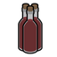 | **Blood wine** | Fine blood, aged and sealed in a bottle the way a vintner keeps wine. A vampire drinks it for the pleasure as much as the vitae, and it keeps for a month without a freezer. |
| 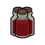 | **Vial of Kindred vitae** | A stoppered vial of vampire blood from the ghoul trade. Nobody will say whose it was. A vampire who drinks it takes no bond from a stranger, but Kindred blood is easy to get a taste for. |
| 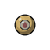 | **Vitae focus** | A small gold bead with a point of vampire blood sealed inside by Thaumaturgy. A vampire who crushes it drinks the blood back. |
| 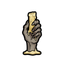 | **Hand of glory** | A dead hand made into a candle by a Necromancy ritual. Light it and every outsider asleep nearby stays asleep for hours. |
| 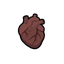 | **Vampire's heart** | A shrivelled heart that still beats, very slowly, outside its body. Its vampire can't be staked while it is away, and meets Final Death if it is destroyed. |
|  | **Illusory figure** | A figure that looks real from any distance. It isn't there. |
| 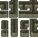 | **Illusory wall** | A stretch of wall that looks solid enough to stop anything. Nobody can see through it, but anyone who touches it may find their hand goes in. |
| 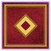 | **Illusory splendour** | Gilt, velvet, candlelight and fresh flowers, laid over whatever is really there. The room looks and smells like a palace, and feels like one to anyone who doesn't touch the walls. |
| 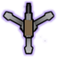 | **Illusory turret** | A gun emplacement that draws every eye and every shot. It never fires. |
| 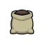 | **Sack of earth** | A sack of earth dug from this place. To a Tzimisce Embraced here it is home, and it has to be close by when they sleep. |
|  | **Sealed casket** | A small lacquered box, sealed with wax and a Prince's mark. Whatever is inside is none of your business. |
|  | **Tavern counter** | A counter for selling drinks, drugs and meals. Every few evenings guests come by, buy from the counter and any shelf in the tavern if they like your prices, leave the silver on the counter, and stay to sit and talk. The tavern is the tavern area if you mark one, or else the room the counter stands in. Prices are set here or from any shelf in the tavern, and the tavern can be closed for the night. Beds marked for tavern guests are rented out for the night. Guests asleep or drunk make easy vessels, if nobody sees. |
|  | **Unidentified relic** | Something old, wrapped in rotten cloth, that feels wrong to hold. Nobody here knows what it is. It can be examined at a ritual circle or ossuary altar, or picked up and used blind, which is a risk. |
|  | **Holy symbol** | A carved symbol of faith, small enough to carry. In most hands it's only a keepsake. Carried by someone of strong True Faith, it burns the Kindred they strike with wounds that heal like fire. |
| 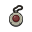 | **Personal talisman** | An object bound to one sorcerer by Thaumaturgy. Worn by its maker once it has settled, it strengthens their blood magic and holds a little of their blood. To anyone else it's a trinket. |

## Weapons

The stake is a vampire hunter's tool first: driven through the heart of a downed vampire it holds
the body rigid (see [Being Kindred](Being-Kindred.md#staking)). The rest are hunters' weapons, and
two of them use fire, which hurts Kindred worst of all.

| | Weapon | Damage | What it is |
|---|---|---|---|
|  | **Wooden stake** | 10 melee | A sharpened length of wood. Driven through a vampire's heart, it holds the body rigid until someone pulls it out.  It can be used as a weapon. Against the living it's a poor knife. A thrust that finds a vampire's heart sometimes stays there. |
| 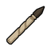 | **Quiescent stake** | 9 melee | A stake carved under a Thaumaturgy ritual. Wound a vampire with it and the tip breaks off and works its way to the heart over a few hours. The rest of the stake crumbles. |

## Buildings and furniture

The coffin and the ritual circle are built from the Furniture and Misc tabs. Most of the rest
appear when a power or ritual makes them: a vampire sunk into the earth, an illusion, a wall of
water, living furniture made with Fleshcraft.

### The tavern

Build a tavern counter (Furniture tab) to open a tavern. Guests come after dark, buy from the
counter and from any shelf in the tavern, and rent beds marked for them. Prices, guests and
feeding on them are on [the tavern's own page](Tavern.md).

| | Name | What it is |
|---|---|---|
| 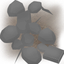 | **Disturbed earth** | A patch of freshly turned soil. Something is lying under it. |
| 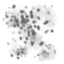 | **Heap of ash** | A heap of sticky white ash, damp to the touch. It stirs now and then. |
|  | **Figure in the stone** | The faint outline of a winged shape, sunk into the rock. |
| 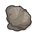 | **Blood cocoon** | A hard white shell of dried blood and fluids, the size of a person. Something inside it shifts now and then. |
|  | **Persistent echo** | A faint shimmer in the air, and a sound just too quiet to hear. Enemies who step into it hear it all at once. |
| 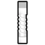 | **Pillar of Osiris** | A place made holy by long meditation. Those who know the discipline of Bardo find their minds clear and their Beasts quiet here. |
| 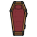 | **Coffin** | A long box with a lid that shuts tight. A vampire sleeping inside is safe from the sun even without a roof overhead. Anyone can sleep in one. |
| 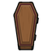 | **Sealed coffin** | An old coffin, its lid fixed down long ago. Something lies inside. Whatever it is has waited a long time and may not take kindly to being woken. |
| 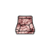 | **Flesh armchair** | A chair grown out of a living person. Their skin is the upholstery and their ribs are the frame, and it's warm to sit in.  They're still in there. They don't age or need food. A vampire with Fleshcraft can shape them back into a person. If it's broken apart, they fall out downed; destroyed any other way, they die. |
| 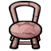 | **Flesh chair** | A dining chair grown out of a living person, folded at the waist with the back held straight.  They're still in there. They don't age or need food. A vampire with Fleshcraft can shape them back into a person. If it's broken apart, they fall out downed; destroyed any other way, they die. |
| 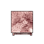 | **Flesh table** | A table grown out of a living person, on all fours with the back spread flat and wide. People eat off it.  They're still in there. They don't age or need food. A vampire with Fleshcraft can shape them back into a person. If it's broken apart, they fall out downed; destroyed any other way, they die. |
| 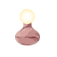 | **Flesh lamp** | A lamp grown out of a living person, drawn up tall and thin. A dim red light shows through the stretched skin, and it never needs fuel or power.  They're still in there. They don't age or need food. A vampire with Fleshcraft can shape them back into a person. If it's broken apart, they fall out downed; destroyed any other way, they die. |
| 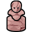 | **Flesh sculpture** | A living person worked into a twisting knot of limbs and faces, made to be looked at. Kindred call it art.  They're still in there. They don't age or need food. A vampire with Fleshcraft can shape them back into a person. If it's broken apart, they fall out downed; destroyed any other way, they die. |
| 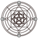 | **Ritual circle** | A circle of stone, wood or metal inlaid with silver and marked with occult signs. Blood magic of the third level and above is worked standing inside it, and rituals are taught here. |
| 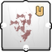 | **Ossuary altar** | A low platform of stone, wood or metal laid with old bones in careful patterns. Necromancy rituals of the third level and above are worked standing on it, and necromancers teach their rituals here. |
| 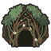 | **Dome of branches** | A dome of branches, leaves and vines grown tight together. A stranger can't find a way in. Something sits inside it. |
|  | **Wall of water** | Water standing straight up out of nowhere, as solid as a wall. It will fall at dawn. |
|  | **Shape under the water** | Something lies still just under the surface. From some angles it looks like a sleeper. |
| 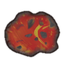 | **Molten rock** | Glowing rock welling out of the ground. Anything that touches it burns. |
|  | **Heart vessel** | A sealed jar of thick glass in a metal cage, made to hold a vampire's heart once Serpentis has taken it out. A heart kept in it can't be burned, cut or shot while the vessel stands. Hunters and enemy Kindred who know what is inside will try to break it open. |

## Recipes and surgeries

| Recipe | Done at | What it does |
|---|---|---|
| **Draw blood** | Surgery, on a bed | Draw blood from this person and seal it in vials. They will be weak from blood loss for a day or so. |
| **Remove stake** | Surgery, on a bed | Pull the stake out of this vampire's heart. |
| **Cut out heart (heart of darkness)** | Surgery, on a bed | Take a vampire's heart out of its chest and keep it somewhere safe. Only a surgeon with Serpentis 5 can do it. Without its heart the vampire can't be staked, but if the heart is destroyed, so is the vampire. |
| **Install Brass Heart Shield** | Surgery, on a bed | Set the Brass Heart Shield over the heart. |
| **Install Eye of Hazimel** | Surgery, on a bed | Set the Eye of Hazimel into an eye socket, replacing what is there. |
| **Graft Hand of Conrad** | Surgery, on a bed | Graft the Hand of Conrad onto a wrist, replacing the hand. |
| **Stake with a Nail of Dismus** | Surgery, on a bed | Drive a Nail of Dismus through a helpless vampire's heart. It stakes like wood and drains the vampire's Willpower every day it stays. |
| **Make blood wine** | Brewery | Age fine blood vials into bottles of blood wine. |
| **Make sack of earth** | Crafting spot | Dig up a sack of earth from this place. |

## Creatures

The things powers call up or wake. Most fight for whoever made them and go when the power ends.

| | Name | What it is |
|---|---|---|
|  | **Risen dead** | Someone who died, called back by Necromancy as a ghost or a walking corpse. |
|  | **Salamander** | A spirit of fire in the shape of a long lizard of glowing coals. Its touch sets things alight, and fire can't hurt it. |
|  | **Sylph** | A spirit of the air, a gust that holds the shape of a great bird. Fast and hard to hit, but its blows are light. |
|  | **Gnome** | A spirit of the earth, a hunched thing of packed soil and stone. Slow, very hard to hurt, and it hits like a rockfall. |
|  | **Undine** | A spirit of water, a coiling serpent of it, solid enough to grab and drown a man. Fire can barely touch it. |
|  | **Walking tree** | A tree that has pulled its roots out of the ground to fight. Slow and enormously strong, it shrugs off clubs and fists, but it burns. |
|  | **Walking statue** | A statue moving like a living thing, slow and heavy. Fists and clubs barely chip it. |
|  | **Walking furniture** | A chair, a table or a lamp scuttling about on its own legs and battering whoever it is set on. |
|  | **Dancing blade** | A weapon hanging in the air with no hand on it, cutting at whoever comes near. |

[← Contents](README.md)

---

This is not official World of Darkness material. Portions of the materials are the copyrights
and trademarks of Paradox Interactive AB, and are used with permission. All rights reserved. For
more information please visit worldofdarkness.com.
