# Relics and lore

## Relics

Relics are rare items with power in them. Named artifacts exist once per world. Each clan also has
a relic that works better for its own members. A relic's effect is on whoever wears it, wields
it, or keeps it in their haven.

### Finding them

- **Torpor crypts.** World sites where an old vampire sleeps behind wards, with a relic beside it.
  Lore texts, court gossip and missions reveal them.
- **Missions** at court, elder raiders, gifts for big boons, and the anonymous benefactor.
- **The occult trader.** A caravan that only visits colonies with Kindred, selling lore texts and
  the odd relic.

### Identifying them

Relics are found unidentified. Learn what one is by examining it at the ritual circle, by using
Auspex's The Spirit's Touch on it, or by risking it and using it blind.

### The relics

| | Relic | What it is |
|---|---|---|
|  | **Sargon Fragment** | A charred scroll in a lead case, said to be the work of the founder of the Cappadocians and to hint at a rite for becoming something more than Kindred. It is written in old Chaldean and makes no sense to anyone short of mastery in blood sorcery or Necromancy. A vampire who can work through it learns a Necromancy ritual and much about the occult. Many who have read it were never quite right after. |
|  | **Tablet of Destiny** | Clay tablets of laws that legend ties to the First City. Very hard to read, and worth it: a vampire who masters them gains a great deal of experience and can take up the Path of Caine with no mentor, once it has fallen far enough from Humanity. |
| 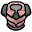 | **Fleshcrafted armour** | A shell of hardened flesh and bone plates, grown together from a corpse by Vicissitude. It turns blades and blows well. It is also unmistakably made of a person, and any mortal who sees it worn knows something is very wrong. |
| 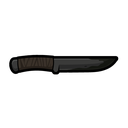 | **Quietus blade** | A knife with a dark sheen to the steel, treated with Assamite blood venom. Its next few hits carry aggravated venom whoever holds it. When the venom is spent it is an ordinary knife. |
| 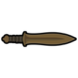 | **Sword of Nul** | A bronze short sword older than writing, said to have been forged by a demon for a vampire of the First City. Every cut it makes drinks: the victim bleeds out faster and a vampire who wields it is fed. The Beast likes it too. A Kindred wielder has to fight off frenzy each time it drinks. |
| 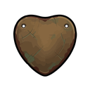 | **Brass Heart Shield** | A curved plate of engraved brass made to sit over a vampire's heart under the ribs. No ordinary stake gets through it. Stakes made by ritual still find a way. It is heavy and the body never forgets it is there. |
| 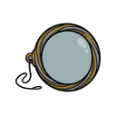 | **Monocle of Clarity** | A Tremere-ground lens in a silver rim, made long ago to find Nosferatu hiding in plain sight. For a blood point and a hard look through it, the wearer sees through Obfuscate and Chimerstry as only the oldest Auspex can, and may glimpse other hidden things, the dead among them. Some of what it shows is not meant to be seen. |
| 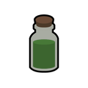 | **Concoction of Vitality** | A stoppered vial of something that smells of crushed grass and iron. A vampire who drinks it turns mortal over the next few hours and stays so for a day: the sun can't burn it and it needs no sleep, but it has no Disciplines at all and a killing blow kills it for good. Only one dose was ever known. |
| 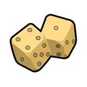 | **Bloodspot Dice** | A pair of yellowed bone dice spotted with old blood. Carried by a vampire, they turn its failures into successes, and every win turns one of the forty-two spots red. With every spot red they stop winning, until someone's throat is cut and the dice are washed in the blood. |
| 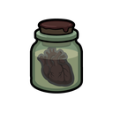 | **Pumping Heart of Nizchetus** | A heart in a jar of green glass, still beating after centuries. Set down in the room where its owner sleeps, it brings them luck: every roll they make is a little easier. Nobody likes sharing a room with it. |
| 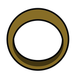 | **Rowan Ring** | A plain ring of rowan wood. In a fight it lengthens into a stake on its wearer's finger, and a lucky thrust can find a vampire's heart. Nobody searching for weapons gives it a second look. It is only wood, and it wears out. |
| 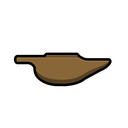 | **Lamp of Constantine** | A small bronze oil lamp whose flame never needs feeding. Its light is the sun's. Kindred within a few strides burn and may flee in terror, and any who stay in its light for long, even from further off, fall into the sleep that comes before dawn. Mortals in it feel steadier. Hunters prize it above anything. A vampire who carries it burns too. |
|  | **Philosopher's Ring** | A heavy silver ring engraved with lines from an argument nobody won. It steadies whoever wears it a little. A Brujah who wears it can call on Willpower to hold back frenzy, as the clan's blood usually won't allow. |
| 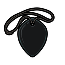 | **Scale of Apep** | A single black scale the size of a palm, hung from a cord at the waist. Its wearer moves with a snake's quickness. A Follower of Set who wears it is no longer troubled by bright light. |
| 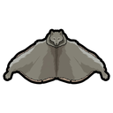 | **Wolf-mother's Pelt** | The pelt of an enormous grey wolf, worn as a cloak. It is warm and turns blows like good leather armour. A Gangrel who wears it takes the shape of the wolf without spending blood. |
|  | **Family Ledger** | A thick, old account book of the Giovanni, every page a debt owed by someone living or dead. Kept in a Giovanni's haven, it makes the dead more willing to listen: one more die on Necromancy powers for a Giovanni on the same map. |
| 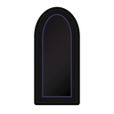 | **Abyssal Mirror** | A tall mirror in a black frame that shows nothing at all, not even the room. Nobody likes it in the house. A Lasombra on the same map spends one less blood on Obtenebration. |
| 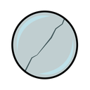 | **Cracked Lens** | A pair of spectacles with one lens cracked in a starburst. The world through it looks a little wrong, and its wearer sees patterns others miss. A Malkavian who wears it gets only true warnings of coming danger. |
| 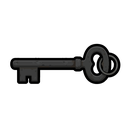 | **Warren Key** | An iron key, black with age, hung at the belt, said to open every door under the old cities. Its bearer digs and tunnels better. A Nosferatu who carries it spends one less blood on Obfuscate. |
| 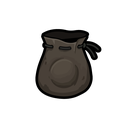 | **Wanderer's Coin** | A worn coin from no country anyone can name, kept in a pouch at the belt. Once a day it turns a vampire's failed roll into another try. A Ravnos who carries it finds the clan's vice a little easier to resist. |
| 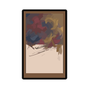 | **Unfinished Masterpiece** | A painting its Toreador maker never finished, and the most beautiful thing many people will ever see. A Toreador on the same map can look at it without being entranced. It restores Willpower each night and keeps the clan's fascination with other works away. |
|  | **Pyramid Seal** | A gold signet ring cut with the mark of the Tremere Pyramid. Anyone who wears it has an easier time with occult matters. A Tremere who wears it works rituals with two more dice and doesn't bond as easily as the clan usually does. |
|  | **Urn of the Old Country** | A clay urn of earth sealed with wax, the soil of a place long gone. On a map with it, a Tzimisce rests as if on native soil, and the earth inside never runs out. |
| 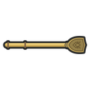 | **Sceptre of Lineage** | A short gilded sceptre topped with a Ventrue crest. It hits like a club and lends its holder an air of command. In a Ventrue's hand, every contested mental power gets a die more. |
| 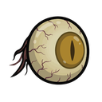 | **Eye of Hazimel** | A living eye, wet and watchful, said to have belonged to a Ravnos of terrible age. Set into an empty socket it sees better than any eye, shows a vampire host visions of what is coming, and lends the powers to bend sight and flesh. It also changes whoever carries it, a little at a time, and never for the better. |
| 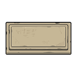 | **Enosch Sarcophagus** | A sealed stone coffin carved with figures nobody can name, believed to hold a vampire of the second or third generation. It has never been opened and can't be. Keeping it raises the colony in the eyes of its sect, and draws rogues who want it for themselves. |
| 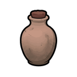 | **True Vessel** | A plain clay jar that the Giovanni say was made to hold their founder's blood and soul. Whoever holds it has leverage over the family, which the sect values and the family does not forgive. |
| 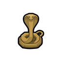 | **Uraeus of Osiris** | A golden serpent with lapis eyes, worn at the belt. It once sat on Osiris's crown. Its bearer can see the dead without Necromancy, and by burning the body of a mortal sacrifice can open a way into the Egyptian lands of the dead. The dead notice in return: once a season something may follow the bearer home. |
|  | **Skull of Saulot** | A smooth old skull in a silver cage, said to be what remains of the Salubri founder after his killers were done. Thaumaturgy worked in the same room is stronger. Nobody who keeps it sleeps well for long. |
| 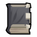 | **Waxen Poetica** | A small wax tablet with verses scratched into it. Washed in blood and thrown, it latches on and spreads: after a few seconds the wax burns, worse every moment, and once it covers someone they can't move, and a mortal can't breathe. It comes off only if it cools by itself. One use. |
| 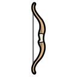 | **Ivory Bow** | A bow of rowan and ash backed with carved ivory. Its arrows wound vampires the way fire does, and the wounds heal as slowly. The ivory is old and cracks with use. |
| 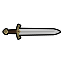 | **Sword of Dracula** | An ornate broadsword etched with eastern letters and older signs, made to kill a demon. Its wounds are aggravated to anyone, and it drinks every cut it makes: the blade darkens from silver to red, and the blood stays fresh inside until a vampire wielder draws it out through the hilt. Those who think it belongs to them never stop looking for it. |
| 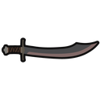 | **Ainkurn** | A curved Turkish blade, sister to the Sword of Dracula. Each cut drinks from its victim straight into a vampire wielder's veins. Its owners want it back as much as the other. |
| 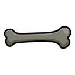 | **Femur of Toomler** | A massive thigh bone, polished by handling, said to come from a Tzimisce elder of the fourth generation. Its blows wound vampires as fire does. The Tzimisce would like it back. |
| 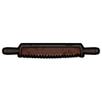 | **Talbot's Saw** | A two-handed bone saw, rusted brown, once owned by a Gangrel killer. Its teeth have never dulled. It tears through anything, and the stories say whoever carries it can't be shot, cut or burned. That isn't quite true, but bullets, blades and fire do only half the harm they should. |
|  | **Martinelli's Ring of Clear Thought** | A gold ring made for a Malkavian elder who wanted, now and then, to think straight. While it is worn, no derangement can surface. Taking it off lets them all back in at once and worse than before, and the wearer can think of nothing but getting it back. |
| 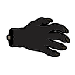 | **Hand of Conrad** | A mummified hand, still supple, said to have belonged to a mighty Brujah. Grafted onto a wrist in place of the hand that was there, it is stronger than any hand should be, hits harder, and brings some of its owner's nerve with it. There are stories that it can raise the dead, which nobody believes. |
| 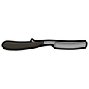 | **Aaron's Feeding Razor** | A pearl-handled razor made by a Malkavian who couldn't bear the touch of his prey. A vampire carrying it feeds from a thin cut at arm's length: quicker, with no Kiss, and it looks like an ordinary wound. It finds its way to the purest blood, people who have never had a lover, before anyone else's. As a weapon it is small, and its cuts are aggravated. |
| 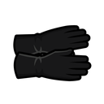 | **Black Gloves** | Black velvet gloves that grow steel claws when their wearer wants a fight, ghoul or mortal or Kindred. Claws are hard to explain to anyone watching. |
| 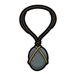 | **Phylactery of Recorded Memory** | A banded granite amulet hung at the belt, holding the memories of everyone who wore it before. A new wearer gains a share of their skills, and a vampire a share of their occult lore. Not all of those memories were human, and the strangest can crack a mind. |
| 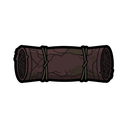 | **Tapestry of the Blood** | A vast old tapestry of tangled threads that seem to move when nobody looks straight at them. Soaked in ten points of a vampire's blood and watched for a whole night, it shows scenes of the Kindred past, present and future: who the strangers nearby really are, courts nobody has mentioned, the places where elders sleep. What it shows can break a mind. The Tremere want it badly. |
|  | **Vestment of Vileness** | A priest's robe, stained and heavy, with a blessing and a curse on it. It lends its wearer the Sepulchre Path's first four powers, but only if they know no Necromancy of their own. Anyone the wearer loves who comes close enough to touch is doomed to waste away. |
| 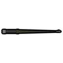 | **Tyrant's Lash** | A plain horse whip with a small barb at the tip, made by a Tzimisce sorcerer for those who rule. In the hand of a vampire on the Path of Power and the Inner Voice, every stroke makes the one it cuts feel small and helpless: those who can't stand up to it fall to their knees, and a few never get all of their will back. In anyone else's hand it is just a whip. |
| 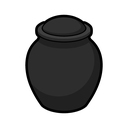 | **Venetian Jar** | A black Roman funeral jar dug up in Venice, cold to the touch. Once a season someone can reach the dead through it. With a body laid beside it and a vampire's blood poured in, it calls that soul back into the flesh; otherwise the dead answer questions about where old things sleep or where courts meet. Sometimes one of the dead follows the question back. |
| 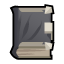 | **Codex Caecitus** | A huge book locked with iron, its pages in a cipher about the dead. Kept in a haven, it gives up a Necromancy ritual written out plain once a season. The Giovanni send people to take it back. |
| 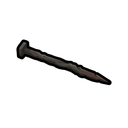 | **Nails of Dismus** | Long nails of a metal nobody can name. Driven into a vampire's heart, by surgery or by hand, one stakes like wood and drains the staked of Willpower at every dawn, as nightmares that never stop fill the sleep. The spirit tied to them doesn't like being disturbed. |
|  | **Jorum of Kinsmanship** | A bowl of dark carved wood, stained from the inside. Everyone who shares a Vaulderie poured into it comes away bound to the others as tightly as the Vinculum goes. |
|  | **Chalice of Kinship** | A black chalice with no maker's mark. Packs who share the Vaulderie from it hold together like family, for better or worse. |

## Lore texts

Lore texts are vanilla books. A Kindred reader gains experience, and when it finishes a text it
may learn a ritual, hear of Golconda, or recognise a relic.

| | Text | What it is |
|---|---|---|
|  | **Fragment of the Book of Nod** | Loose pages copied and recopied from the Book of Nod, the Kindred's oldest scripture. Vampires read them for what they say about Caine, the first generations and the end of nights. A Kindred reader gains experience, may hear of Golconda, and now and then recognises a relic from its pages. |
|  | **Erciyes Fragments** | Clay and parchment copies of the oldest known passages of the Book of Nod, found in a buried city. Hard going even for a learned vampire, and some of it should not be read too closely. It hints at where old things lie. |
|  | **Treatise** | A vampire's notes on one Discipline: what it learned, what went wrong, what it would tell a younger Kindred. A reader who already has the Discipline, at fewer dots than the writer had, learns from it. To anyone else it is a strange book. |
|  | **Thaumaturgic grimoire** | A Tremere working book with one ritual of Thaumaturgy written out in full: the words, the signs and what has to be bled. A sorcerer who reads it and is strong enough in the art learns the ritual. Better copies hold harder rituals. |
|  | **Necromantic ledger** | A Giovanni ledger that mixes the family's accounts with one Necromancy ritual written out in full. A necromancer strong enough in the art learns the ritual by reading it. Better copies hold harder rituals. |
|  | **Path primer** | A short book that sets out one Path of Enlightenment: its beliefs, its hierarchy of sins and what its followers must give up. A vampire who has fallen far enough from Humanity can take it in place of a mentor and begin a season of study. |
|  | **Clan history** | One clan's history as its own members tell it, flattering where it can be. Any vampire learns from it, and a vampire of that clan learns twice as much. |
|  | **Hunter's journal** | A hunter's notebook: sightings, mistakes and what worked against the things they hunted. A Kindred reader learns what hunters look for. A mortal reader may come away believing, and belief is how True Faith starts. One taken from a hunter who came here may say which breach of the Masquerade led them to the colony. |
|  | **Inquisition record** | Records of the Society of Leopold: names, sightings and suspected havens. Reading what the hunters know about this colony shows where the colony has been careless and lowers the breach of the Masquerade a little. |
|  | **Sargon Fragment** | A charred scroll in a lead case, said to be the work of the founder of the Cappadocians and to hint at a rite for becoming something more than Kindred. It is written in old Chaldean and makes no sense to anyone short of mastery in blood sorcery or Necromancy. A vampire who can work through it learns a Necromancy ritual and much about the occult. Many who have read it were never quite right after. |
|  | **Tablet of Destiny** | Clay tablets of laws that legend ties to the First City. Very hard to read, and worth it: a vampire who masters them gains a great deal of experience and can take up the Path of Caine with no mentor, once it has fallen far enough from Humanity. |
|  | **Koldun's book of the land** | A koldun's book, part prayer and part instruction, on drawing power out of earth, wind, water and fire. A Tzimisce who reads it through can learn the Ways without a teacher. To anyone else it is strange poetry. |

## Craftable items

Blood vials, blood wine, coffins, ritual circles, stakes and the rest are on
[Items and buildings](Items-and-Buildings.md).

[← Contents](README.md)

---

This is not official World of Darkness material. Portions of the materials are the copyrights
and trademarks of Paradox Interactive AB, and are used with permission. All rights reserved. For
more information please visit worldofdarkness.com.
